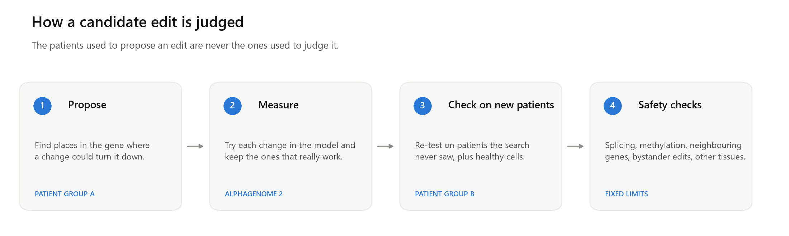
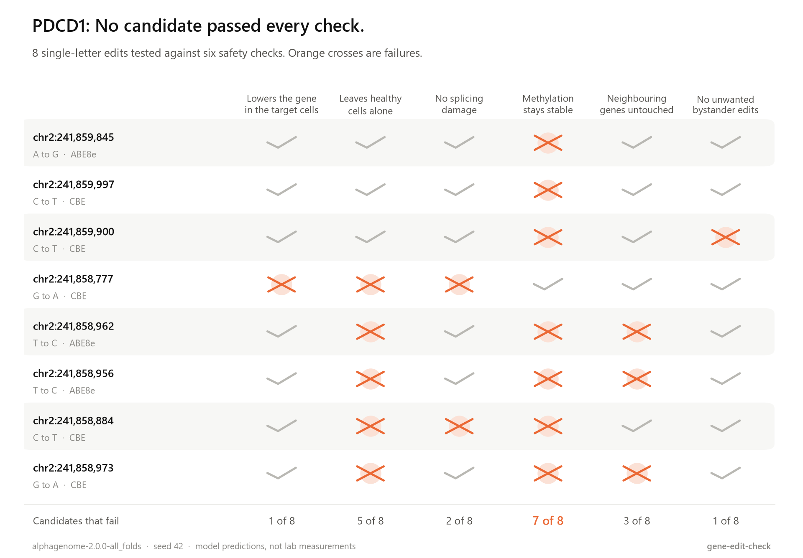
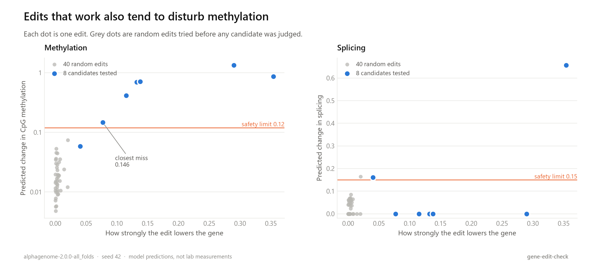
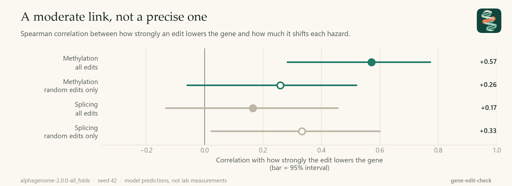
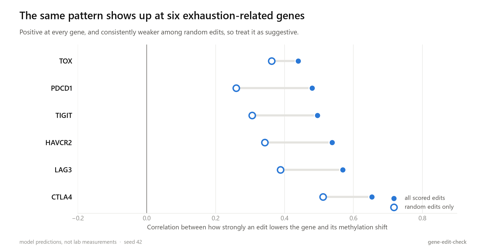
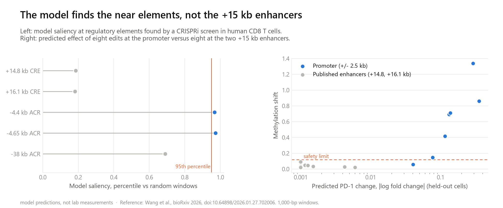

# gene-edit-check

**Checks, on a computer, whether a gene edit works only in the cells you want, before anyone spends weeks testing it in a lab.**

[](https://github.com/aravmendiratta/gene-edit-check/actions/workflows/ci.yml)
[](https://pypi.org/project/gene-edit-check/)


A computational-biology toolkit built on Google DeepMind's AlphaGenome 2.

---

## The problem

Gene-editing tools can now change a single letter of DNA. That makes a precise kind of treatment possible: turn
one gene down in the cells that cause trouble, and leave every other cell alone.

The hard part is knowing, in advance, whether a given edit will do that. Testing each candidate in a lab takes
weeks. And an edit can look good where you aimed it while quietly doing damage elsewhere: in healthy cells, in
the genes next door, or in the chemical tags that keep DNA working properly.

**gene-edit-check does that homework on a computer first.** You give it a gene and two kinds of cell, the ones
you want to change and the ones you want to leave alone. It proposes single-letter edits, predicts what each
one would do in both, and runs the survivors through a set of safety checks. What comes out is a short list of
edits worth taking to a lab, or a clear reason why there isn't one.



The part that keeps it honest: the patients' cells used to *propose* an edit are never the ones used to *judge*
it, and every claim of "it works" has to beat a crowd of random edits first.

## What it found

The worked example is **PD-1**. Many tumours switch off the immune system's T cells by leaning on a protein
called PD-1, so turning PD-1 down in tumour T cells is a real strategy. The catch is that T cells in healthy
tissue also use PD-1, so the edit has to be selective. We used real single-cell data from colorectal cancer
(62 patients, [Pelka et al., *Cell* 2021](https://doi.org/10.1016/j.cell.2021.08.003)) and let AlphaGenome 2 play
the judge.

**No edit passed every check.** Eight single-letter edits were tested against six safety checks. Seven of the
eight disturbed DNA methylation, the chemical tags that help control which genes are active, more than the
safety limit allows. The closest miss was 0.146 against a limit of 0.12.



**A pattern showed up underneath.** The more strongly an edit turned PD-1 down, the more it also shifted
methylation. The sign was the same at all six exhaustion-related genes we tried. It is a moderate link, not a precise
one, and the data cannot yet say whether it is specific to methylation or something every strong edit does.







**A check against a lab screen.** A published CRISPRi screen in human T cells found PD-1 regulatory elements
at +14.8 and +16.1 kb from the gene. We asked whether the model points at them. It recognises two elements
near the promoter, but not the two +15 kb enhancers, and single-base edits there are predicted to do almost
nothing. So every effective edit the search found sits in the promoter, which is also where the methylation
damage is. That fits the pattern above, but it does not prove it. Details and caveats are in
[docs/RESULTS.md](docs/RESULTS.md#checked-against-a-wet-lab-screen).



**Why a negative result is useful.** It tells a lab which edits not to spend months on, and it points to the
real obstacle (methylation at this gene) rather than leaving a vague sense that "it didn't work".

**What it does not mean.** These are predictions from a model, not lab measurements. An earlier draft of this
project claimed a much stronger link (a correlation of +0.94). A larger random comparison did not support it,
so it was retracted, and the numbers above are the corrected ones. The full account, including what did not
hold up, is in [docs/RESULTS.md](docs/RESULTS.md).

> *Research use only. Nothing here is validated in a lab or fit for clinical, diagnostic or therapeutic use.*

### Plain-language glossary

| Term | What it means here |
|---|---|
| **Base edit** | Changing one letter of DNA (for example A to G) without cutting the strand. |
| **Cell state** | A kind of cell in a particular condition, such as "exhausted T cell inside a tumour". |
| **Methylation** | Chemical tags on DNA that help switch genes on and off. Disturbing them can have wide effects. |
| **Splicing** | How a gene's raw copy is cut and joined into a finished message. Edits can break it. |
| **AlphaGenome 2** | A DeepMind AI model that predicts what a DNA change does in different cells. |
| **Random null** | A crowd of random edits tried first, so a "good" edit has to beat chance, not just look good. |

---

## Install

```bash
pip install gene-edit-check                 # the command-line tool and Python library
pipx install gene-edit-check                # same, in its own isolated environment (recommended for the CLI)
pip install "gene-edit-check[mcp]"          # also adds the server for AI coding agents
```

Needs Python 3.11 or newer. From source: `pip install git+https://github.com/aravmendiratta/gene-edit-check`.

## What happens when you install it

You get one command, `gene-edit-check`, and an importable Python package. Installing does not download
data, call any API or create any files. Nothing happens until you run something.

| You have | You can do | Needs |
|---|---|---|
| **Nothing else** | Check your setup, browse AlphaGenome 2's 2,799 reference conditions ranked by how well the model actually knows each one, run the plumbing with the simulator | just the install |
| **A free API key** | Run the full pipeline on the built-in colorectal and breast cancer cohorts and get a report and figure | key, plus a one-time 396 MB atlas download |
| **Your own `.h5ad` file** | Run the same pipeline on any single-cell dataset, for any target gene | key, plus your data |

### 30 seconds, no key

```bash
gene-edit-check doctor                                   # what is set up, and where files will go
gene-edit-check conditions "CD8-positive"                # which reference conditions are best evidenced
```

### A real run

```bash
export ALPHAGENOME_API_KEY=...               # free, non-commercial: https://deepmind.google.com/science/alphagenome
                                             # PowerShell: $env:ALPHAGENOME_API_KEY='...'   or put it in a .env file
gene-edit-check optimize                    # PD-1 in exhausted colorectal-cancer T cells
```

The first run downloads the Pelka et al. 2021 atlas (396 MB, once) and takes a few minutes. It makes tens of
AlphaGenome calls and caches every response, so repeating a run is fast and free. You get:

- a **terminal report**: the candidate edits, each check it passed or failed, and why
- `outputs/report_crc-pd1-exhaustion.json`: the full machine-readable record
- `outputs/figure_crc-pd1-exhaustion.png`: a one-page summary: the scorecard, the efficacy-versus-hazard chart and its confidence intervals

Without a key, a real-data run stops and tells you how to get one. It will not quietly substitute fake output.

### Your own data

```bash
gene-edit-check run-h5ad \
  --h5ad my_atlas.h5ad --gene-id ENSG00000188389 --gene-symbol PDCD1 \
  --target-query "cell_type == 'CD8 T cell' and condition == 'tumour'" \
  --healthy-query "cell_type == 'CD8 T cell' and condition == 'normal'" \
  --cell-type "CD8-positive" --tissue "colon"
```

The file needs raw integer UMI counts (in `.raw.X`, `.layers["counts"]` or `.X`) and a column identifying the
patient or donor. Cell groups are selected with pandas queries, including `expr_GENE > 0` conditions. The
Tier 2 reference condition is chosen automatically from your `--cell-type`.

## Who this is for

- **Someone designing a state-selective regulatory edit** who wants a cheap first pass before committing to
  wet-lab work: does the model think this edit moves the gene in the cells you care about and not in the ones
  you don't, and what does it break on the way?
- **Anyone using AlphaGenome 2** who wants a better way to pick a reference condition. `gene-edit-check
  conditions` ranks them by whether the model saw real training data or only imputed it. Only 185 of 2,799
  human conditions have observed methylation.
- **Single-cell groups** who need to condition AlphaGenome on a population but are limited to 256 cells. The
  coreset sketching and patient-disjoint hold-out are reusable on their own.
- **Researchers evaluating verifier-guided search**, with a worked and honest negative result.

It is not a guide-RNA design tool, it does not predict off-target cutting, and it does not replace experiments.

## Use it from Python

```python
from gene_edit_check.conditions import search_conditions, evidence_profile

hits = search_conditions("CD8-positive", modality="methylation")   # strongest evidence first
print(hits[["condition", "biosample_name", "methylation"]].head())
print(evidence_profile("UBERON:0000178_CL:0000625"))               # blood CD8 T cell: all four 'observed'
```

The full pipeline is `gene_edit_check.pipeline.run_scenario`. The scripted simulator in
`gene_edit_check.ag_backend.simulator` lets you test code offline; its output is not a prediction.

## Use it from an AI agent

- **Skill.** `skills/alphagenome_v2_single_cell_crispr/SKILL.md` teaches an agent how to drive the CLI and how to
  report results honestly.
- **MCP server.** `gene-edit-check-mcp` exposes `run_optimization_tool`, `list_scenarios_tool` and
  `search_conditions_tool` to any MCP-capable agent.

## Where files go

| What | Where |
|---|---|
| Reports and figures | `./outputs/` in the folder you run from |
| Downloaded atlases and cached AlphaGenome responses | a per-user cache folder (`%LOCALAPPDATA%\gene-edit-check`, `~/Library/Caches/gene-edit-check`, or `~/.cache/gene-edit-check`) |
| Override the cache location | set `GENE_EDIT_CHECK_HOME` |

`gene-edit-check doctor` prints the exact paths on your machine.

## Limits and terms

- AlphaGenome 2 is used under its [non-commercial terms](https://deepmind.google.com/science/alphagenome/terms),
  and you need your own API key. The code here is MIT licensed; the model and its predictions are not.
- No wet-lab validation. "Selective" means AlphaGenome 2 says so.
- The healthy comparators are imperfect (memory-like colon T cells, not naive ones), the Tier 2 hazard
  reference is blood CD8 T cells because the colon one is only imputed, and the breast cohort has 5 patients.

## Develop

```bash
git clone https://github.com/aravmendiratta/gene-edit-check && cd gene-edit-check
uv venv --python 3.12 .venv && uv pip install --python .venv/Scripts/python.exe -e ".[dev,mcp]"
pytest                    # offline: no API key and no download needed
```

## Cite

Pelka et al., *Cell* 2021 (data); Wu et al., *EMBO J* 2020 (breast cohort); Avsec et al. and Google DeepMind
(AlphaGenome). See [CITATION.cff](CITATION.cff) and [references/citation.bib](references/citation.bib).
