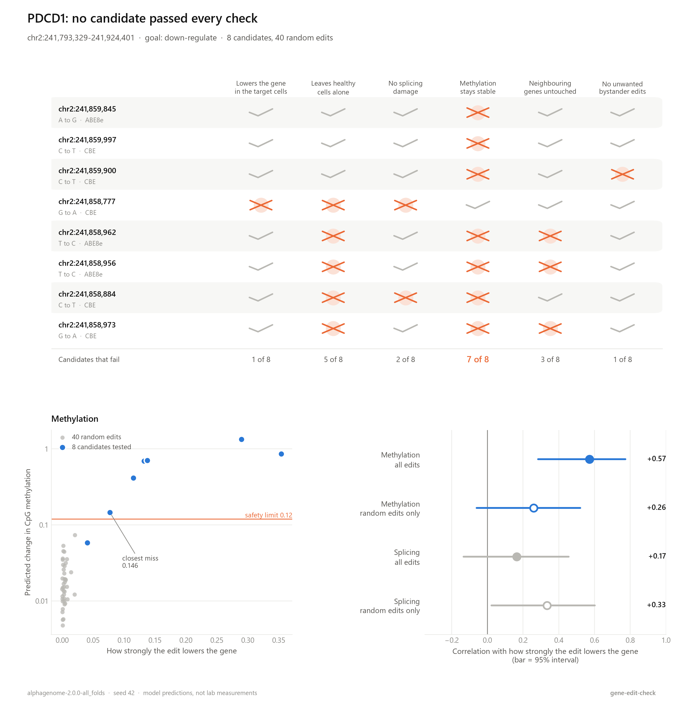

# CRISPR-Reflexion

> A verifier-guided search for **cell-state-selective CRISPR base edits**, using Google DeepMind's
> **AlphaGenome 2** as the judge. Test case: turn **PD-1 (*PDCD1*)** down in the exhausted T cells
> inside real colorectal tumours while leaving normal-colon T cells alone.
>
> *Research use only. Outputs are computational hypotheses from the AlphaGenome 2 API, not validated
> for clinical, diagnostic or therapeutic use.*

---

## The headline result

The search **did not find a usable edit** — and the interesting part is *why*.

Across 20 scored variants at the *PDCD1* locus, how much an edit silences PD-1 and how much it
disrupts CpG methylation are almost the same quantity:

**Spearman ρ = +0.94 (p = 8 × 10⁻¹⁰, n = 20)**

Three things make that more than a curiosity:

1. **It isn't selection bias.** It holds among the 12 *randomly chosen* edits alone (ρ = +0.73,
   p = 0.0065), which were scored before any candidate was verified.
2. **It isn't "the model's outputs all move together".** Splicing, a different output head, shows
   no coupling at all (ρ = −0.05, p = 0.84).
3. **It isn't universal.** Running the identical pipeline across six checkpoint loci gives a
   structured answer, not a flat one.

| Gene | CpG ρ | random-only ρ | splice ρ | gap | class | blocked by |
|---|---|---|---|---|---|---|
| **PDCD1** | **+0.92** | +0.75 | −0.30 | **+1.22** | **methylation-specific** | methylation 5/5 |
| **LAG3** | **+0.82** | +0.55 | +0.10 | **+0.72** | **methylation-specific** | methylation 5/5 |
| HAVCR2 | +0.90 | +0.68 | +0.88 | +0.02 | generic hazard coupling | methylation 5/5 |
| CTLA4 | +0.76 | +0.21 | +0.81 | −0.05 | generic hazard coupling | healthy selectivity 5/5 |
| TIGIT | +0.62 | +0.18 | +0.65 | −0.03 | generic hazard coupling | healthy selectivity 5/5 |
| TOX | +0.30 (ns) | −0.02 | +0.00 | +0.30 | uncoupled | healthy selectivity 5/5 |

At *PDCD1* and *LAG3*, the sequence features that carry expression appear to be the CpGs
themselves, so a single base edit that silences the gene without moving methylation may not exist
there. That is a mechanistically sensible result — the *PDCD1* regulatory regions are CpG-dense and
their demethylation is part of how T-cell exhaustion is established — and it is a **falsifiable
claim about where to stop looking**, which is more useful than a candidate nobody checked.

**This is a statement about what AlphaGenome 2 has learned, not a measurement of chromatin.** No
wet-lab validation was performed. See [Honest limitations](#honest-limitations).



---

## What the tool does, in plain words

Tumours wear T cells out ("exhaustion"). PD-1 is the brake on them, and the PD-1 drugs
(Keytruda, Opdivo) release it. The question here is: *could a single DNA letter be edited so PD-1
turns down only in the exhausted tumour T cells, and not in healthy ones?*

1. **Real cells in.** 77k T/NK cells from 62 colorectal-cancer patients, tumour and normal colon.
2. **Shrink to a sketch.** AlphaGenome 2 accepts at most 256 cells to describe a cell state, so
   representative cells are chosen by facility-location coreset in the model's own latent space —
   with patients kept disjoint between the "proposal" sketch and the held-out "verification" sketch.
3. **Gradients propose.** One gradient call shows which DNA positions matter for PD-1 in those
   cells. Only edits a base editor can actually make survive (PAM site, editing window, bystanders).
4. **ISM measures direction.** In-silico mutagenesis over compact windows measures what each
   substitution really does, *before* any verification budget is spent on it.
5. **Two tiers verify.** Right direction, beats random edits, spares healthy T cells, doesn't drag
   neighbouring genes, no new splice sites, no large methylation shift, nothing in off-target tissues.
6. **The critic learns from each failure** and re-ranks what to try next.

---

## Why the architecture looks like this

Each of these was a bug or a blind spot found by running the thing, not a design flourish.

### Gradients say *where*, not *which way* — so measure it
The gradient sign is a first-order heuristic: positive means "more of this base → more expression",
so replacing it should lower expression. Audited against ISM ground truth, **it is right only 70% of
the time.** Trusting it wasted whole verification rounds on edits that *raised* PD-1. The pipeline
now spends 10 ISM calls up front, each measuring every substitution in an 8 bp window, and the
verifier only ever sees candidates whose direction is already known.

*Effect: wrong-direction candidates reaching verification went from 4/8 to 1/8.*

### A hazard verdict is only as good as its evidence
`supported_conditions()` returns 2,799 human reference conditions and, per modality, whether the
model has **observed** tracks, a **validated** imputation, or an **unvalidated** one. Only 185 of
2,799 have observed methylation. So the reference condition isn't hard-coded — it is chosen by
evidence, and every hazard call is stamped with the tier it came from.

This resolved a real question. The anatomically correct condition is colon CD8 T cell
(`UBERON:0001155_CL:0000625`), but it is `imputed_exploratory` for both methylation and splicing.
Blood CD8 (`UBERON:0000178_CL:0000625`) is the only CD8 condition that is **observed** for
methylation, splicing, RNA-seq *and* TF ChIP. The pipeline uses blood CD8 as primary and colon CD8
as a **concordance check** — and reports when they disagree rather than averaging them. On the
finalist edit they *do* disagree (blood 0.146 → fail, colon 0.087 → pass), which is exactly the
kind of thing that should be shown, not smoothed over.

```bash
crispr-reflexion conditions "CD8-positive" --modality methylation
```

### The expression scorer already returns the neighbours — don't throw them away
Scoring a variant returns every gene in the interval, and the old code kept one row. Keeping the
rest costs nothing and catches edits that hit a shared regulatory element: three candidates were
caught dragging ***RTP5*** along with PD-1 (up to 66% of the on-target effect).

### An edit is delivered to cells, not to a cell state
Tier 1 asks whether an edit is selective *between cell states*. It cannot ask what happens in the
liver. The finalist is scored against six non-immune reference tissues; it **flags hepatocyte
(0.049) and brain (0.040)** against a bar of 0.039.

### A failed search has two very different explanations
Either the optimiser was bad, or the target is constrained. Those call for opposite responses, so
the run measures which one it is and says so — that analysis is the headline result above.

---

## Data

**Pelka et al., *Cell* 2021**, via CZ CELLxGENE Discover ("T, NK, ILC cells", collection
`4d82bd8e-…`, dataset `7674f8f4-…`). Raw UMI counts, Ensembl IDs, 10x 3′ v2/v3. States are the
**authors' own annotations**:

| State | Definition | Cells | Patients |
|---|---|---|---|
| Target `Exhausted_CD8_TIL` | tumour CD8 T cells, clusters cTNI14/15/16 (`CD8+ CXCL13+`) | 12,738 | 62 |
| Healthy `Normal_Colon_CD8` | CD8 T cells from adjacent normal colon | 2,626 | 36 |

Sanity check on raw counts (per 10k UMI): *PDCD1* 1.80 vs 0.26, *CXCL13* 25.97 vs 0.03,
*IL7R* 0.92 vs 4.89. The 396 MB file downloads automatically on first run into `data/` (git-ignored).

---

## Does the model actually see the cell state?

Before trusting any edit prediction, the conditioning itself has to be checked. `validate-fidelity`
compares AlphaGenome 2's predicted tumour-vs-normal fold-change against what the real cells show,
across a fixed 24-gene immune panel:

- **Spearman ρ = +0.65 (p = 0.0005)**, **94% sign agreement** on the 17 genes that genuinely move.
- The model **compresses** real differences to ~56% of their true size (*PDCD1*: observed ln FC
  +1.65, predicted +0.43).

This validates the conditioning. It says nothing about edit effect sizes, which have no ground truth here.

## Coresets

Facility-location sketches in AlphaGenome's latent space cut MMD² by ~50% versus random
subsampling (0.00135 vs 0.00280 target; 0.00140 vs 0.00277 healthy). Sketch A and Sketch B share
**zero patients**.

---

## Quickstart

```bash
uv venv --python 3.12 .venv
uv pip install --python .venv/Scripts/python.exe -e ".[scverse,dev]"
cp .env.example .env            # add ALPHAGENOME_API_KEY (free, non-commercial)

crispr-reflexion optimize                  # main run: Pelka CRC real data, live API
crispr-reflexion sweep-coupling            # 6 checkpoint loci comparison
crispr-reflexion sweep-universality        # multi-seed, subtypes, lineages, TNBC, CpG architecture
crispr-reflexion validate-fidelity         # predicted vs observed fold-changes
crispr-reflexion ablate-sketch             # coreset vs random subsampling
crispr-reflexion conditions "CD8-positive" # evidence tiers per reference condition
pytest                                     # 53 offline tests (no API, no download)
```

### Bring your own single-cell atlas (`run-h5ad`)

The verifier is dataset-, cancer-, and lineage-agnostic. Point it at any local `.h5ad` file or CZ CELLxGENE Discover URL containing raw integer UMI counts (`.raw.X`, `.layers["counts"]`, or `.X`), select your target/control populations via pandas queries (including optional `expr_<GENE>` count predicates), and it automatically picks the highest-evidence Tier 2 reference condition for your `--cell-type`:

```bash
crispr-reflexion run-h5ad \
  --h5ad https://datasets.cellxgene.cziscience.com/4d036b2c-6135-4515-9c44-a5aa7a2e32e5.h5ad \
  --gene-id ENSG00000188389 --gene-symbol PDCD1 \
  --target-query "celltype_final == 'CD8+ T-cells' and (expr_LAG3 > 0 or expr_HAVCR2 > 0 or expr_CXCL13 > 0)" \
  --healthy-query "celltype_final == 'CD8+ T-cells' and expr_LAG3 == 0 and expr_HAVCR2 == 0 and expr_CXCL13 == 0 and (expr_IL7R > 0 or expr_CCR7 > 0)" \
  --cell-type "CD8-positive" --tissue "breast"
```

---

## Multi-seed, cross-cancer & cross-lineage invariance (`sweep-universality`)

To test whether the *PDCD1* finding is an artifact of one seed, one colorectal cancer cohort, or one T-cell subtype, `crispr-reflexion sweep-universality` evaluates multi-seed splits, colorectal tumor mismatch-repair subtypes (`MMRd` vs `MMRp`), distinct T-cell lineages (`CD8+`, `CD4+ CXCL13+`, `PDCD1+ γδ`), and an independent **Triple-Negative Breast Carcinoma** atlas (**Wu et al., *EMBO J* 2020**, 24,271 cells, CELLxGENE `4d036b2c`)—auto-resolving Tier 2 hazard references via `resolve_reference_pair()` (`outputs/universality_report.json`):

### 1. Multi-seed stability (CRC CD8+ TILs, independent patient splits & null draws)

| Seed | CpG ρ | CpG p | Random-only ρ | Splice ρ | Gap (CpG − Splice) | Grad Sign Agree | Class |
|---|---|---|---|---|---|---|---|
| `42` | **+0.921** | 1.1×10⁻⁶ | +0.746 | −0.661 | +1.583 | 68% | **methylation-specific** |
| `7` | **+0.932** | 4.2×10⁻⁷ | +0.770 | −0.500 | +1.432 | 65% | **methylation-specific** |
| `99` | **+0.864** | 3.2×10⁻⁵ | +0.551 | −0.083 | +0.947 | 66% | **methylation-specific** |
| **Mean ± SD** | **+0.906 ± 0.037** | — | **+0.689** | — | — | — | **3/3 invariant** |

### 2. Cross-cancer, cross-subtype & cross-lineage consistency (*PDCD1*)

The overall CpG correlation is positive and significant in all six contexts. The **random-edit-only control** (the one that rules out selection bias) is **not**: it holds in 3 of 6 and is near zero in the other 3. Read the last column before the first.

| Context | Cohort (target cells) | Auto-resolved Tier 2 ref [tier] | CpG ρ | CpG p | Splice ρ | Gap | Class | Random-edit-only ρ |
|---|---|---|---|---|---|---|---|---|
| CRC All CD8+ TILs | Pelka 2021 (12,738) | blood CD8 [observed] | **+0.921** | 1.1×10⁻⁶ | −0.661 | +1.58 | **methylation-specific** | +0.75 (holds) |
| CRC MMRd / MSI-H CD8+ | Pelka 2021 (10,582) | blood CD8 [observed] | **+0.729** | 2.1×10⁻³ | +0.012 | +0.72 | **methylation-specific** | +0.08 (fails) |
| CRC MMRp / MSS CD8+ | Pelka 2021 (2,156) | blood CD8 [observed] | **+0.886** | 1.1×10⁻⁵ | −0.704 | +1.59 | **methylation-specific** | +0.64 (holds) |
| CRC CD4+ CXCL13+ Helper TILs | Pelka 2021 (2,135) | blood CD4 [observed] | **+0.689** | 4.5×10⁻³ | +0.105 | +0.58 | **methylation-specific** | +0.01 (fails) |
| CRC PDCD1+ γδ TILs | Pelka 2021 (3,204) | blood γδ T [imp_exploratory] | **+0.718** | 2.6×10⁻³ | −0.344 | +1.06 | **methylation-specific** | +0.05 (fails) |
| **Breast Cancer (TNBC) CD8+** | **Wu 2020 (2,162)** | **blood CD8 [observed]** | **+0.804** | **3.1×10⁻⁴** | **−0.455** | **+1.26** | **methylation-specific** | +0.35 (weak) |

### 3. Physical GRCh38 CpG architecture (±2.5 kb cis-window around TSS)

| Gene | GC% | CpG count | CpG / 100 bp | CpG Obs/Exp | Efficacy vs CpG ρ | Class |
|---|---|---|---|---|---|---|
| **PDCD1** | **61.4%** | **143** | **2.86** | 0.303 | **+0.92** | **methylation-specific** |
| **LAG3** | **60.6%** | **151** | **3.02** | 0.330 | **+0.79** | **methylation-specific** |
| HAVCR2 | 42.6% | 60 | 1.20 | 0.266 | +0.89 | generic hazard coupling |
| CTLA4 | 41.3% | 32 | 0.64 | 0.150 | +0.76 | generic hazard coupling |
| TIGIT | 46.6% | 35 | 0.70 | 0.130 | +0.62 | generic hazard coupling |
| TOX | 52.3% | 240 | 4.80 | 0.702 | +0.30 (ns) | uncoupled |

Notice the structural split on physical GRCh38 DNA sequence alone (zero dependence on model output heads): **`PDCD1` and `LAG3` share ~61% GC and ~3.0 CpGs/100 bp** with methylation-specific coupling, whereas `CTLA4`/`HAVCR2`/`TIGIT` are AT-rich / CpG-sparse (`0.64–1.20 CpGs/100 bp`, generic hazard coupling). Meanwhile **`TOX` carries a classic CpG island** (`Obs/Exp = 0.702 > 0.60`), yet remains **`uncoupled`**—showing CpG island presence alone is not sufficient for coupling.

---

## How it is kept honest

- **Held out by patient.** Sketch B never contains a patient from Sketch A.
- **Null-calibrated efficacy.** A candidate must beat 12 random PAM-valid edits at the same locus
  (empirical p ≤ 1/13). Thresholds are fixed before any candidate is verified.
- **Direction matters.** Silencing means the edit must *lower* PD-1; a large increase fails.
- **Tiers never mix.** Tier 1 is single-cell-conditioned expression; Tier 2 is reference-condition
  hazards. The API forbids both conditions in one call, and the report never claims single-cell
  resolution for a Tier 2 number.
- **Evidence tiers are reported**, so an `imputed_exploratory` verdict can be discounted.
- **The simulator is not a result.** `--simulator` is a scripted offline stand-in that hard-codes
  where the "selective" site is. It prints a red warning and exists for plumbing tests and CI only.
- **Thresholds were not tuned after seeing results.** The closest miss fails methylation at 0.146
  against a limit of 0.12. The limit was not moved.

## Honest limitations

- **No wet-lab validation.** Every number is a prediction from one model. "Selective" means
  AlphaGenome 2 says so.
- The coupling result is a correlation **between two model outputs**. The random-edit control rules
  out selection bias and the splice control argues against generic entanglement, but neither proves
  the mechanism is real chromatin biology.
- Predicted effect sizes are compressed (slope ~0.56), and the efficacy null has only 12 edits.
- Tier 2 hazards use a **blood** CD8 reference, because the colon one is exploratory-imputed. The
  tissue-matched cross-check disagrees on the finalist.
- The healthy comparator is normal-colon CD8 T cells — mostly IL7R⁺/GZMK⁺ memory-like, not naive.
- Tested across two independent solid-tumour cohorts (Pelka et al. 2021 CRC, 62 patients; Wu et al. 2020 TNBC, 5 patients), three random seeds, and three T-cell lineages, but still does not include blood malignancies or healthy non-epithelial organs beyond reference conditions; the six-locus sweep remains CRC-anchored.
- **Unresolved discrepancy:** the universality report gives splice ρ = −0.66 for PDCD1 seed 42; re-running the identical scenario and settings from cache gives −0.30. The CpG numbers match exactly. Until that is explained, treat the splice column as unverified.
- **TNBC is not patient-disjoint.** It has 5 patients, below the 6 needed for a donor split, so Sketch A/B were split by cell and the held-out-by-patient guarantee does not apply to that row. Its target/healthy groups are also defined by marker expression, and the healthy group is non-exhausted tumour T cells, not normal tissue.
- The γδ row uses an `imputed_exploratory` reference, the weakest evidence tier.
- Note that the random-edit-only correlation reaches nominal p < 0.05 primarily in larger/all-donor CD8 cohorts (`ρ = +0.73..+0.77`) and drops when conditioned on smaller single-lineage or 5-donor subsets (`ρ = +0.01..+0.35`, n = 10 random edits), even as the full 15-variant coupling stays significant (`p ≤ 0.0045`) everywhere.

## Citation

Pelka et al. 2021 (data); Avsec et al. / Google DeepMind (AlphaGenome). See
[references/citation.bib](references/citation.bib).
