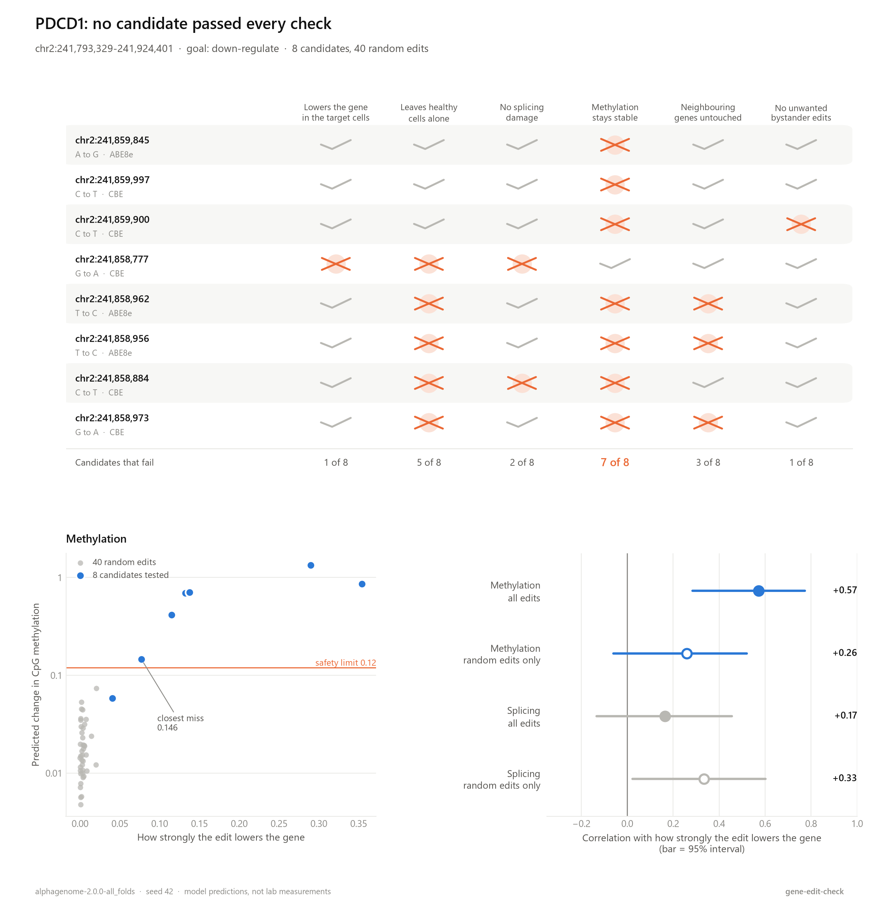

# Results

What the live AlphaGenome 2 runs found, with the controls and the parts that did not hold up. Back to the [README](../README.md).

## Headline

The search **did not find a usable edit**. Of 8 verified candidates, 7 were blocked by the CpG-methylation
check, and the closest near miss fails it at 0.146 against a limit of 0.12.

The finding underneath that is an **association between how much an edit silences PD-1 and how much it
disturbs CpG methylation**. It is real in this data, but smaller and less specific than a first pass
suggested, so this section separates what holds from what does not.

**What holds**

- Across all 48 variants scored in the main run, efficacy and CpG shift are positively correlated:
  **Spearman rho = +0.57, 95% bootstrap CI +0.28 to +0.77 (p = 2.2e-05)**. The interval is wide: the data support a
  moderate association, not a precise size.
- It reproduces across three independent seeds (patient splits and random-edit draws): rho = +0.48, +0.56, +0.57, all p < 1e-3.
- The sign is positive in **all 6 cohorts** (rho from +0.25 to +0.73) and at **all 6 checkpoint loci** (rho from +0.44 to +0.65).

**What does not hold**

- **It is not near-identity.** An earlier version of this README reported rho = +0.94 at *PDCD1*. That came
  from 20 variants and a 12-edit random null. With a 40-edit null it is about +0.5, and I have retracted
  the stronger claim.
- **The selection-bias control is inconclusive.** Among the 40 random edits alone (chosen before any
  candidate was verified), rho = +0.26 (p = 0.106) in the main run, and +0.26, +0.37, +0.39 across the three seeds. Consistently positive, but
  not individually significant, so I cannot rule out that the pooled correlation is partly produced by
  how candidates were selected.
- **It is not specific to methylation.** Among random edits, splicing also correlates with efficacy
  (rho = +0.33, p = 0.036). The earlier "splicing shows nothing" control came
  from a smaller null and does not survive.
- **The labels flipped, so the classifier now uses intervals.** The earlier "methylation-specific / generic /
  uncoupled" labels used a fixed rho cutoff that the same data crossed depending on null size and seed. They
  now come from a paired bootstrap of the gap between the methylation and splice correlations. In the main run
  the gap is +0.41 with 95% CI -0.02 to +0.82: it just includes zero, so the data cannot separate a
  methylation-specific effect from every hazard rising together. The pooled splice correlation is +0.17
  (CI -0.13 to +0.46); among random edits alone it is +0.33 (CI +0.02 to +0.60).

**Reading it.** The simplest explanation is generic rather than *PDCD1*-specific: edits that move predicted
expression a lot also tend to shift predicted methylation across a 1.2 kb window. This design cannot
tell that apart from a CpG-borne regulatory mechanism, and both are statements about AlphaGenome 2's
predictions, not measurements of chromatin. No wet-lab validation was performed.

---

## Data

**Pelka et al., *Cell* 2021**, via CZ CELLxGENE Discover ("T, NK, ILC cells", collection
`4d82bd8e-…`, dataset `7674f8f4-…`). Raw UMI counts, Ensembl IDs, 10x 3′ v2/v3. States are the
**authors' own annotations**:

| State | Definition | Cells | Patients |
|---|---|---|---|
| Target `Exhausted_CD8_TIL` | tumour CD8 T cells, clusters cTNI14/15/16 (`CD8+ CXCL13+`) | 12,738 | 62 |
| Healthy `Normal_Colon_CD8` | CD8 T cells from adjacent normal colon | 2,626 | 36 |

Sanity check on raw counts (per 10k UMI): *PDCD1* 1.80 vs 0.26, *CXCL13* 25.97 vs 0.03,
*IL7R* 0.92 vs 4.89. The 396 MB file downloads automatically on first run into `data/` (git-ignored).

---

## Does the model actually see the cell state?

Before trusting any edit prediction, the conditioning itself has to be checked. `validate-fidelity`
compares AlphaGenome 2's predicted tumour-vs-normal fold-change against what the real cells show,
across a fixed 24-gene immune panel:

- **Spearman ρ = +0.65 (p = 0.0005)**, **94% sign agreement** on the 17 genes that genuinely move.
- The model **compresses** real differences to ~56% of their true size (*PDCD1*: observed ln FC
  +1.65, predicted +0.43).

This validates the conditioning. It says nothing about edit effect sizes, which have no ground truth here.

## Coresets

Facility-location sketches in AlphaGenome's latent space cut MMD² by ~50% versus random
subsampling (0.00135 vs 0.00280 target; 0.00140 vs 0.00277 healthy). Sketch A and Sketch B share
**zero patients**.

---

## Robustness checks (`sweep-universality`, `sweep-coupling`)

All runs use a 40-edit random null, 5 iterations, 8 ISM pre-screen windows, live AlphaGenome 2.
Every cohort is split into proposal and verification sketches **by patient** with zero overlap.

### Seeds (CRC CD8+ TILs, independent patient splits and null draws)

| Seed | CpG rho | CpG p | Random-edit-only rho | Splice rho |
|---|---|---|---|---|
| 42 | +0.48 | 8.5e-04 | +0.26 | +0.20 |
| 7 | +0.56 | 7.5e-05 | +0.37 | -0.04 |
| 99 | +0.57 | 4.3e-05 | +0.39 | -0.01 |

Mean CpG rho = +0.535 +/- 0.049; mean random-edit-only rho = +0.338.

### Cohorts, subtypes and lineages (*PDCD1*, seed 42)

| Context | Target cells / patients | Auto-resolved Tier 2 reference [evidence] | CpG rho | p | Random-edit-only rho | Splice rho |
|---|---|---|---|---|---|---|
| CRC All CD8+ TILs (Pelka 2021) | 12,738 / 62 | blood CD8-positive, alpha-beta T cell [observed] | +0.48 | 8.5e-04 | +0.26 | +0.20 |
| CRC MMRd / MSI-H CD8+ TILs | 10,582 / 34 | blood CD8-positive, alpha-beta T cell [observed] | +0.30 | 0.047 | +0.00 | +0.22 |
| CRC MMRp / MSS CD8+ TILs | 2,156 / 28 | blood CD8-positive, alpha-beta T cell [observed] | +0.73 | 1.6e-08 | +0.61 | -0.28 |
| CRC CD4+ CXCL13+ Helper TILs | 2,135 / 60 | blood CD4-positive, alpha-beta T cell [observed] | +0.25 | 0.098 | -0.06 | -0.30 |
| CRC PDCD1+ gamma-delta TILs | 3,204 / 58 | blood gamma-delta T cell [imputed_exploratory] | +0.42 | 0.004 | +0.18 | -0.00 |
| Breast Cancer (TNBC) CD8+ TILs (Wu 2020) | 2,162 / 5 | blood CD8-positive, alpha-beta T cell [observed] | +0.38 | 0.010 | +0.12 | -0.19 |

Sources: CRC from Pelka et al. 2021; breast from Wu et al., *EMBO J* 2020. The TNBC row has 5 patients, so its
sketches are split 2/3 (target) and 1/4 (healthy): patient-disjoint, but the healthy proposal sketch is a single
patient. Its groups are defined by marker expression and the healthy group is non-exhausted tumour T cells,
not normal tissue. The gamma-delta row uses an `imputed_exploratory` reference, the weakest evidence tier.

### Checkpoint loci (same cells, same thresholds)

| Gene | GC | CpG / 100 bp | CpG rho (p) | Random-edit-only rho | Splice rho |
|---|---|---|---|---|---|
| PDCD1 | 61% | 2.86 | +0.48 (8.5e-04) | +0.26 | +0.20 |
| CTLA4 | 41% | 0.64 | +0.65 (1.2e-06) | +0.51 | +0.71 |
| HAVCR2 | 43% | 1.20 | +0.54 (1.4e-04) | +0.34 | +0.58 |
| LAG3 | 61% | 3.02 | +0.57 (4.6e-05) | +0.39 | +0.29 |
| TIGIT | 47% | 0.70 | +0.50 (5.4e-04) | +0.31 | +0.59 |
| TOX | 52% | 4.80 | +0.44 (0.003) | +0.36 | +0.00 |

CpG density of the surrounding sequence (computed directly from GRCh38, independent of the model) does not
clearly predict coupling strength: Spearman rho between CpG density and coupling across the six loci is
-0.60 (n = 6, so there is almost no power to say anything either way).

---

## Honest limitations

- **No wet-lab validation.** Every number is a prediction from one model. "Selective" means
  AlphaGenome 2 says so.
- The association is a correlation **between two model outputs**. The random-edit control is positive but
  not significant, and splicing also correlates among random edits, so neither selection bias nor generic
  entanglement of outputs is ruled out.
- Predicted effect sizes are compressed (slope ~0.56), and the efficacy null (40 edits) is still small.
- Tier 2 hazards use a **blood** CD8 reference, because the colon one is exploratory-imputed. The
  tissue-matched cross-check disagrees on the finalist.
- The healthy comparator is normal-colon CD8 T cells, mostly IL7R⁺/GZMK⁺ memory-like, not naive.
- Tested across two independent solid-tumour cohorts (Pelka et al. 2021 CRC, 62 patients; Wu et al. 2020 TNBC, 5 patients), three random seeds, and three T-cell lineages, but still does not include blood malignancies or healthy non-epithelial organs beyond reference conditions; the six-locus sweep remains CRC-anchored.
